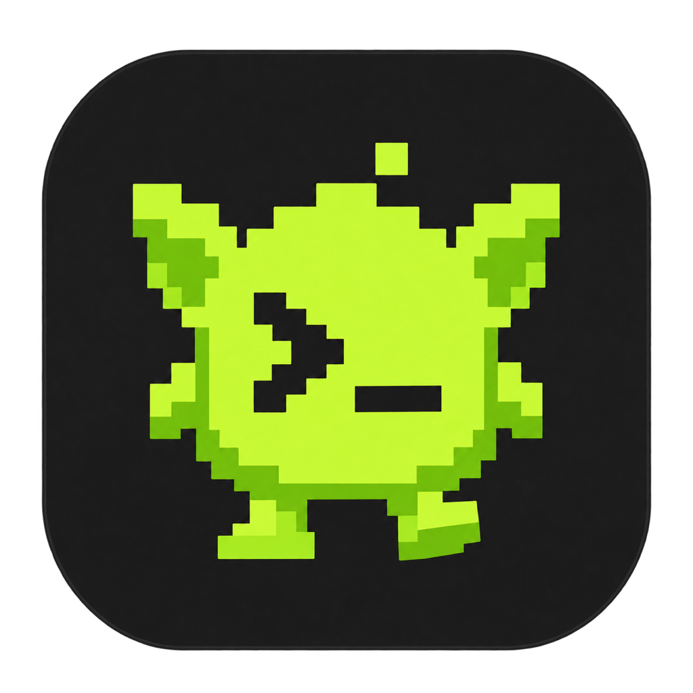
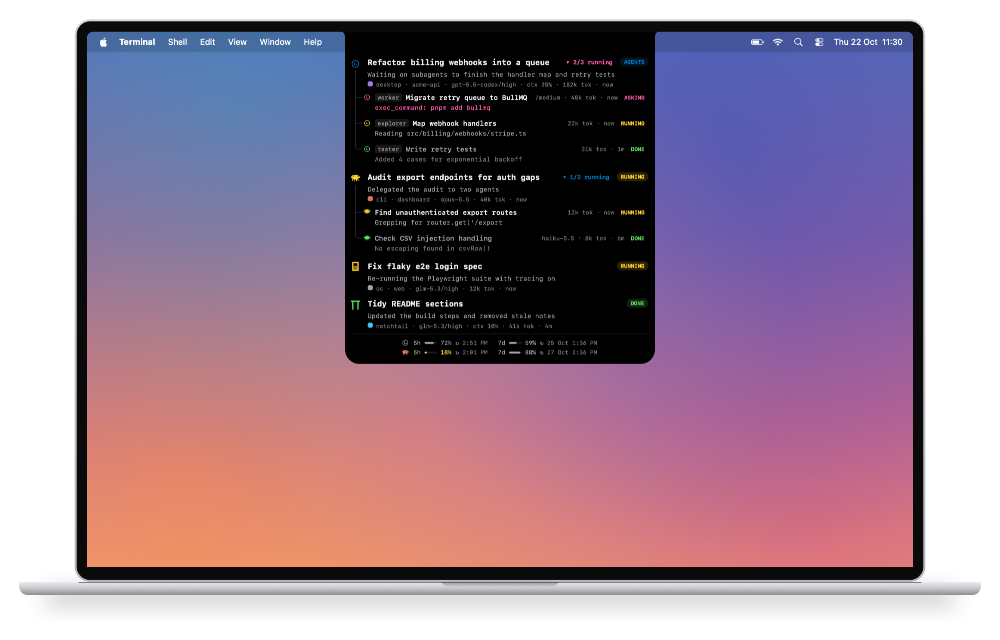
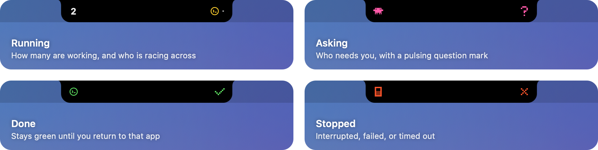

<p align="center">
  
</p>

<h1 align="center">notchtail</h1>

<p align="center">
  
  <br>
  <sub>Rendered from the app's own drawing code with sample sessions.</sub>
</p>

A tiny native macOS status island for Codex, Claude Code (CLI and local Desktop Code sessions), Pi, and **opencode** (v1 and v2 sessions). Agent icons move across the notch while a local turn is running, turn green when complete, orange-red when stopped, and expand on hover (after a brief pause, so a pointer passing by on its way to the menu bar leaves it closed) or click to show sessions with a status pill (`RUNNING`, `AGENTS`, `ASKING`, `DONE`, `STOPPED`), latest response, model, context/token usage, source, project, and grouped subagents. Collapsed, the two sides of the notch mirror each other: the left says who (the running count, or the agent that finished, stopped, or is asking) and the right says what (agents moving across, a green ✓, an orange ✕, or a pink **?**). Idle shows a dim dot on each side. Up to five threads are listed; a `+N more` line counts any that don't fit. Codex uses its circular terminal logo and reads saved thread names from its state database and session index, falling back to the latest prompt when unnamed. Saved names refresh while the app is running.

<p align="center">
  
</p>

When an agent asks you something — a Claude question or plan approval, an opencode question or permission dialog, a pi ask or approval tool, or a Codex persisted approval/input request — the island shows the asking agent's sprite on the left of the notch and a pink pulsing **?** on the right (read-only; answer in the agent's own surface), the row's status turns `ASKING` with the question or the command waiting for approval, and a distinct `Ping` notification sound fires once per ask. Asking threads sort to the top and are exempt from the inactivity stop timeout while they wait on you. Approval variants that a provider keeps only in its live protocol stream remain unavailable to this read-only monitor.

Parent threads stay active while their subagents run, even after the parent finishes its own turn. Completion notifications wait for the last subagent. Active subagents expand automatically beneath the parent as compact two-line rows on a tree: role (e.g. `explorer`), task name, tokens, age, and status, then the current action. A subagent's model appears only where it differs from the parent's (often just the reasoning level, e.g. `/medium`), and finished subagents dim. The parent keeps its own latest response, and its agent-count button shows how many subagents are still running (e.g. `1/2 running`). The button turns pink while a subagent is asking, and a new ask reopens a collapsed group. Hover the button for running, asking, and finished counts; click it to collapse or expand the group. Claude subagents also recognize successful `SubagentHandback` results as completion.

<p align="center">
  
</p>

The expanded footer keeps remaining account-wide limits and reset times visible even when no session is active. Agent icons identify the **Codex** and **Claude** rows, which line their windows up in shared columns; `5h` and `7d` show a small meter and the percentage remaining, followed by `↻` and the local reset time. A window turns yellow at 25% remaining and orange-red at 10%. Weekly resets always include the calendar date. Plans that report only a weekly limit (such as ChatGPT Pro) show `5h no limit` in Codex's row; a dash is reserved for limits that couldn't be loaded. Codex and Claude token counts appear in each thread's details. Claude's API cost estimates are omitted. A dash marks unavailable limits; a lock identifies blocked Keychain access and a warning identifies other fetch failures. Hover for the reason and next step. Screen readers retain the full provider and remaining-usage labels.

It watches Codex's, Claude Code's, and Pi's shared local session events and reconciles them once a second, so the Codex desktop app, CLI, VS Code extension, Claude CLI, local Claude Desktop Code sessions, and Pi can run at the same time without separate integrations. OpenCode reads the local SQLite store (`~/.local/share/opencode/opencode.db`, or the `$XDG_DATA_HOME` equivalent) once a second over a read-only connection: legacy `session`/`message`/`part` tables for v1 sessions and the `session_v2`/`session_message` tables the `opencode2` binary writes for v2 sessions. Channel-specific files next to it (`opencode-<channel>.db`, e.g. from a local `ocfix` build) are watched too, without a restart. Account limits refresh once a minute using authenticated requests to `https://chatgpt.com/backend-api/wham/usage` for Codex and `https://api.anthropic.com/api/oauth/usage` for Claude. Claude uses its existing login from macOS Keychain (`Claude Code-credentials`), or `.credentials.json` under `CLAUDE_CONFIG_DIR`. macOS may ask once to allow the app to read the Keychain item; choose **Always Allow** to permit later background reads. Local ad hoc builds change the app’s identity when its executable changes, so macOS may require approval again after a rebuild; certificate-signed builds retain a stable identity. Custom config directories never fall back to another profile's Keychain login. Tokens are never logged or written by this app, and Claude's credentials are never changed. Failed Claude refreshes keep the last known percentages and reset times, with a warning and hover explanation until a successful refresh. Limits show as unavailable only before any successful fetch. HTTP 429 responses back off before retrying. It animates only while a turn is active.

Claude Code sessions get a coral source marker and a pixel critter, with `cli`, `desktop`, or `extension` shown in each row (Codex rows name their surface the same way). They read the shared `~/.claude/projects/<project>/<session>.jsonl` transcripts, including nested subagents. Titles prefer manual names, then Claude's saved generated titles, then the latest real user message; internal task notifications never replace that fallback. User prompts start turns, tool calls keep them running, final replies or turn-duration records complete them, and interruptions or final API errors stop them. Rows show the latest response, model, and tokens; repeated message snapshots count once, including cache tokens. `AskUserQuestion` and `ExitPlanMode` stay marked `ASKING` until answered or the turn ends. Ordinary tool permissions kept only in the live CLI/Desktop protocol cannot be observed. Claude account limits come from its account API rather than these transcripts; context-window percentages are unavailable from the transcripts. Chat, Cowork, and remote-only Desktop sessions are outside this integration. See [Claude session storage](https://code.claude.com/docs/en/sessions#where-transcripts-are-stored).

Pi sessions get a cyan source marker (Codex: blue = VS Code extension, green = CLI, purple = desktop) and their own pet: a pixelated π sprite bobs while a pi turn runs, moves across the notch eating dots when only pi sessions are active, and follows the Codex logo when both agents run at once. Pi turn state maps 1:1 onto Codex: a user message starts a turn, an assistant reply ending in `toolUse` keeps it running, `stop`/`length` completes it (green + notification), and `aborted`/`error` stops it (orange). Pi model labels show model/thinking level (e.g. `glm-5.3/high`), context percentage uses the context window from `~/.pi/agent/models-store.json`, and session names set with `/name` act as titles.

opencode sessions (v1 and v2) get a silver source marker and their own pet: a pixelated opencode logo (square frame with the cursor block riding low) that bobs while a turn runs and chases behind the other agents when several run at once. Turn state maps onto Codex: a fresh user message or an assistant reply still streaming marks running, a reply segment that ended in tool calls keeps the turn running, a completed reply marks ready (green + notification), and an aborted reply marks stopped (orange). A completed or stopped parent with a still-running subagent is shown as `AGENTS` (blue), making clear that the overall work is active while delegated work continues. Model labels show model/reasoning variant (e.g. `glm-5.3/high`), rows show the session's own title (auto `New session - …` titles fall back to the latest user message), and subagent sessions (`@explore` and friends) group under their parent.

Asks are detected from the same stores the app already watches, read-only. opencode parks native permission/question requests in its pending store when available; legacy tool parts still use the `pending`, `streaming`, or `running` state plus the permission log, and ordinary execution is protected by a debounce. pi ask, confirmation, approval, and permission tools are detected as tool calls whose result entry has not been written yet. Codex persisted `exec_command` escalation and `request_user_input` response items are detected and cleared when their result arrives; provider requests that are live-only cannot be observed.

Completed and stopped threads stay visible for 15 minutes, or until the same thread starts another turn. A completion stays green until you return to its Codex, Claude Desktop, editor, or terminal surface. A silent running turn falls back to stopped after six hours for Codex and thirty minutes for Claude, Pi, and opencode (a fallback for abandoned turns; long silent tools can also reach this timeout).

## Build and run

Requires macOS 13+ and Xcode Command Line Tools.

```sh
make test
make app
open dist/notchtail.app
```

Allow notifications for **notchtail** when prompted. Upgrading from NotchStatus asks again because the renamed app has its own notification identity. If permission or banners are disabled, the collapsed island shows a yellow crossed-out bell and `OFF` on either side of the notch whenever no agent status needs that space. Expand it and select **Open settings** to enable notifications for notchtail. The warning refreshes when you open the island or switch apps and disappears once banners are enabled.

The app has no Dock icon. Click the island or outside it to close. Right-click it for **Launch at Login**, **Notification Settings…**, and **Quit**.

## Keep it running

Move `dist/notchtail.app` to `/Applications`, open it, then right-click the island and choose **Launch at Login** (or add it in **System Settings → General → Login Items**). This uses macOS's native login-item support instead of a background helper.

By default it reads `~/.codex/sessions`, `~/.claude/projects`, `~/.pi/agent/sessions`, and `~/.local/share/opencode/opencode.db` (both table generations). Shell-defined `CODEX_HOME`, `CLAUDE_CONFIG_DIR`, `PI_CODING_AGENT_DIR`, and `XDG_DATA_HOME` are also respected when the app is started from that shell.
