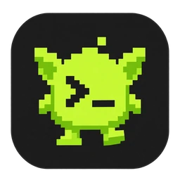
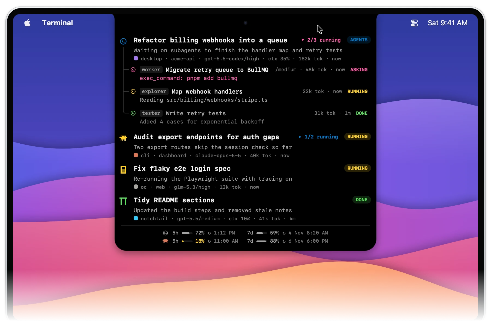
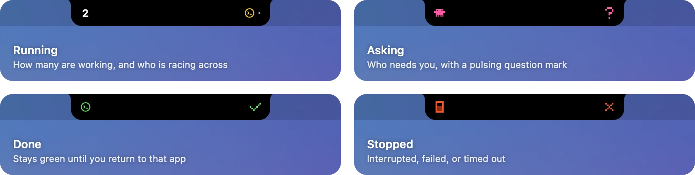
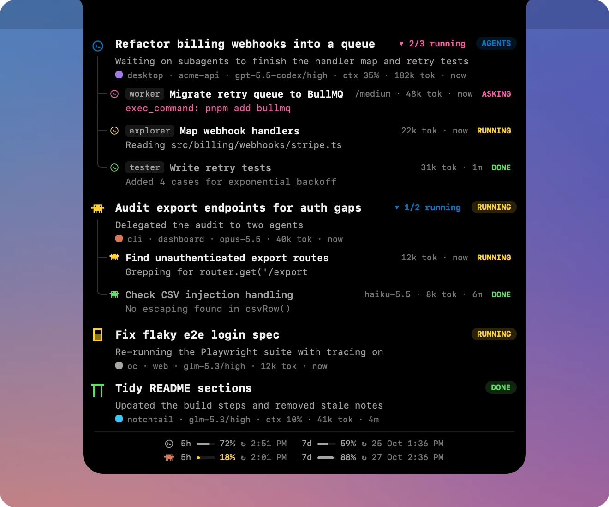

<p align="center">
  
</p>

<h1 align="center">notchtail</h1>

A native macOS notch app for tracking **Codex, Claude Code, Pi, and opencode (v1 + v2)** sessions.

<p align="center">
  
  <br>
</p>

## What it shows

- **Status:** running, waiting for input, done, or stopped—including provider failures.
- **Subagents:** grouped under their parent. Work stays active until the last subagent finishes.
- **Session details:** latest response, model, project, and available token/context usage.
- **Account limits:** remaining Codex and Claude usage, plus reset times.
- **Alerts:** notifications when work finishes or an agent needs your input.

<p align="center">
  
</p>

Hover or click the island to see session details and expand subagent groups.

<p align="center">
  
</p>

## Build and run

**Requires macOS 13+ and Xcode Command Line Tools.**

```sh
make test
make app
open dist/notchtail.app
```

Allow notifications when prompted. For daily use, move `dist/notchtail.app` to `/Applications` and open it there.

## Controls

- **Open:** hover or click. **Close:** click the island or outside it.
- **Start at login:** right-click → **Launch at Login**.
- **Manage alerts:** right-click → **Notification Settings…**. A yellow crossed-out bell means notifications are off.
- **Quit:** right-click → **Quit notchtail**. The app has no Dock icon.

Answer questions and approve commands in the agent's own app or terminal.

## Good to know

- **Read-only monitoring.** Session status comes from local files and databases. Requests that an agent doesn't save locally may not appear.
- **Claude coverage.** Supports CLI and local Desktop Code sessions. Chat, Cowork, and remote-only Desktop sessions are excluded.
- **Account access.** Limits use authenticated requests to OpenAI and Anthropic with your existing logins. Credentials are never logged or changed.
- **Keychain access.** If macOS asks, choose **Always Allow** to let Claude limits refresh in the background. Rebuilding the app may trigger another prompt.

<details>
<summary>Session folders and timeouts</summary>

Default sources:

- Codex: `~/.codex/sessions`
- Claude: `~/.claude/projects`
- Pi: `~/.pi/agent/sessions`
- opencode: `~/.local/share/opencode/opencode.db`, including channel-specific databases.

Custom folders use `CODEX_HOME`, `CLAUDE_CONFIG_DIR`, `PI_CODING_AGENT_DIR`, or `XDG_DATA_HOME` when launched from that shell.

Completed and stopped sessions stay visible for 15 minutes. Silent turns may be marked stopped after 6 hours for Codex or 30 minutes for the other agents.

</details>
